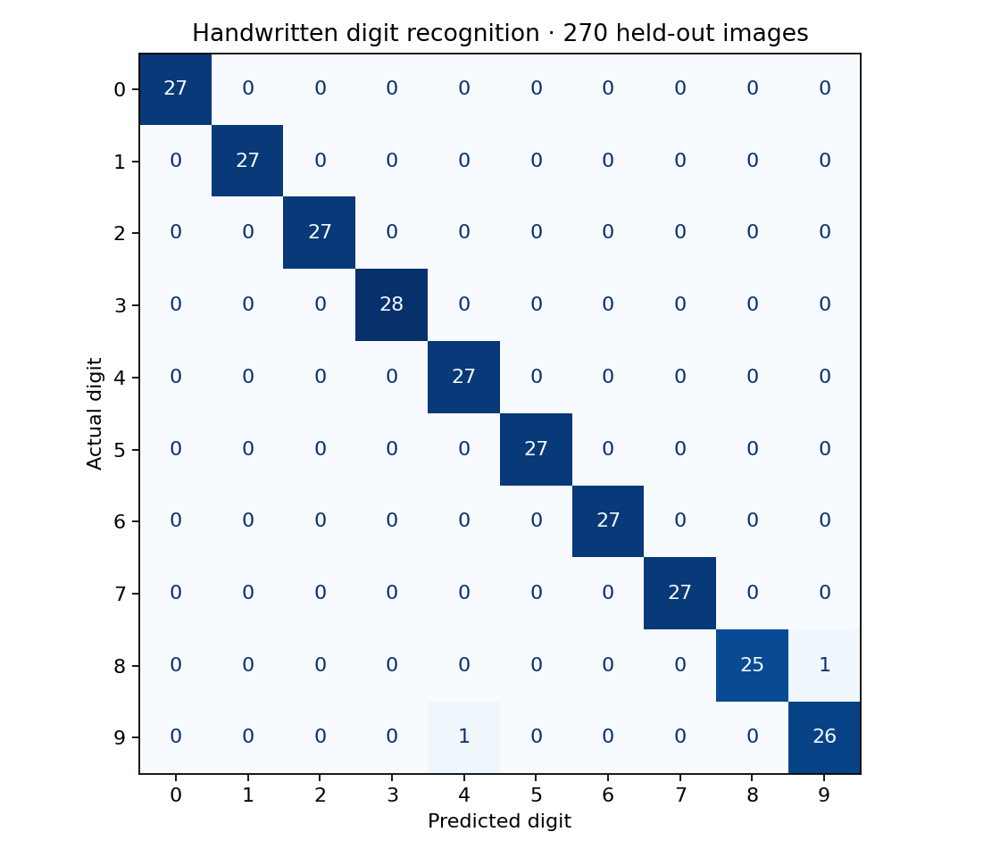
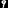
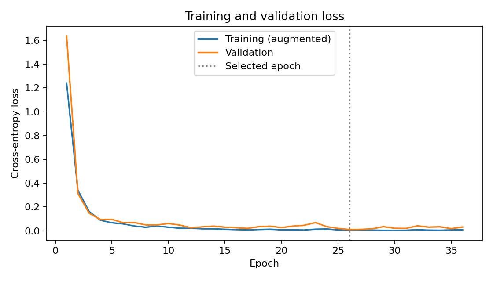

# Handwritten digit classification with a CNN

This PyTorch project recognizes digits 0–9 from grayscale handwriting. The selected model classified 269 of 270 held-out images correctly (99.63%). One 9 was classified as an 8.



## Dataset and evaluation

The public UCI Optical Recognition of Handwritten Digits dataset is distributed in scikit-learn as 1,797 grayscale images, each 8 × 8 pixels. The scikit-learn copy comes from the original UCI test partition. This project creates its own stratified image-level split of that copy with seed 42. It uses 1,257 images for training, 270 for validation and 270 for final testing. Writer identities are unavailable in this loader, so the score applies to this split and does not establish accuracy on unseen writers or phone photos.

Source: [scikit-learn digits dataset](https://scikit-learn.org/stable/modules/generated/sklearn.datasets.load_digits.html) · [UCI dataset](https://archive.ics.uci.edu/dataset/80/optical+recognition+of+handwritten+digits)

## Architecture and training

Pixel values are divided by 16, their known maximum. Three learned 3 × 3 convolutions produce 24, 48 and 64 channels. Each convolution uses padding to preserve spatial dimensions and is followed by batch normalization, ReLU and 2 × 2 max pooling. Pooling reduces each image from 8 × 8 to 4 × 4, 2 × 2 and finally 1 × 1. A 20% dropout layer and a fully connected 64-to-10 layer produce the class logits.

Training applies independent random rotations (±10°) and zoom (0.92–1.08×) to each image in each batch. Digits remain upright. Validation and test images use only pixel scaling. AdamW minimizes cross-entropy at learning rate 0.002, with weight decay 0.001 and batch size 64. Training permits up to 75 epochs and stops after at least 10 epochs when validation loss has failed to improve for 10 consecutive epochs.

## Results

The lowest validation loss was 0.00841 at epoch 44. Training stopped at epoch 54 and restored the epoch-44 weights for test evaluation.

| Test statistic | Value |
|---|---:|
| Accuracy | 99.63% |
| Macro precision | 0.9963 |
| Macro recall | 0.9963 |
| Macro F1 | 0.9962 |

The single error reduced recall for digit 9 to 26/27 and precision for digit 8 to 26/27. All other digits had precision and recall of 1.0 on this split.





## Run locally

Use Python 3.12. Open a terminal in the extracted project folder. For Windows PowerShell:

```powershell
py -3.12 -m venv .venv
.\.venv\Scripts\python -m pip install -r requirements.txt
.\.venv\Scripts\python predict.py results/misclassified-nine.png
.\.venv\Scripts\python train.py
```

On macOS or Linux, create the environment with python3.12 -m venv .venv and use .venv/bin/python for the remaining commands. The included checkpoint works immediately after installation. Running train.py trains from scratch and rewrites the checkpoint and evaluation outputs. The example command predicts 8 for the supplied misclassified 9. To try your own image, supply a tightly cropped, centered digit. Use --invert for dark ink on white paper.

## Project files

- model.py defines the CNN. train.py loads data, augments, trains, selects a checkpoint and evaluates. predict.py classifies one image.
- results/best_model.pt contains the selected state dictionary.
- results/classification_report.csv contains per-class and aggregate precision, recall, F1 and support. results/metrics.json includes accuracy and training metadata.
- results/confusion_matrix.csv and its PNG show actual classes in rows and predicted classes in columns.
- results/history.csv records training loss, validation loss and validation accuracy for every epoch. results/test_predictions.csv records every held-out prediction by dataset index.
